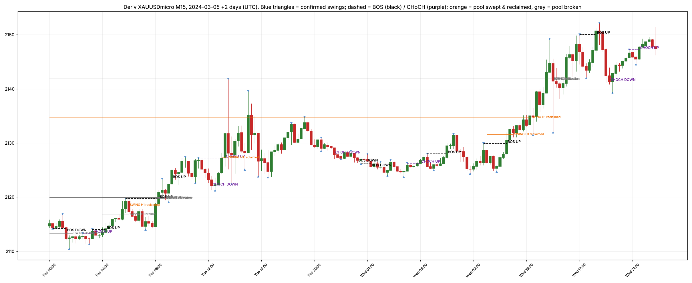

# Stage 2 — Market structure and liquidity engine

**Status:** built and tested. Spec **v0.3**. No trade simulation yet, so there are **no performance results**.

## Modules

| Module | Spec | What it does |
|---|---|---|
| `lh/features/atr.py` | — | Wilder ATR(14) from closed bars |
| `lh/structure/swings.py` | B.1.1 | Confirmed fractal swings (2 left / 2 right). Each swing carries `known_time` = close of the 2nd bar after it |
| `lh/structure/structure.py` | B.1.2–B.1.3 | BOS / CHoCH on candle **close** beyond the last swing ± tolerance; protected levels; regime per bar |
| `lh/liquidity/pools.py` | B.1.4 | Swing, equal-high/low, previous day/week high/low, Asia/London/New York session high/low |
| `lh/liquidity/sweep.py` | B.1.5 | Sweep → reclaim / breakout / no reclaim / expiry for every pool, with depth in ATR units |

## Changes from spec v0.2 (v0.3)

1. **Regime:** BULL/BEAR_TREND = last structure break in that direction was a BOS. The extra "last two swings are HH and HL" condition was dropped: it duplicated the BOS condition and made the definition ambiguous. Swing labels (HH/HL/LH/LL) are still recorded.
2. **Structural failure = CHoCH:** a close beyond the latest confirmed opposite swing. The protected level (pullback low/high) is recorded for Model B and for stop placement.
3. **Pool expiry:** previous-day pools expire at the end of the next trading day; previous-week pools at the end of the next week; session pools after 24 h; swing and equal-level pools after 200 bars of their timeframe (calendar time).
4. **Sessions** (New York time): Asia 18:00–02:00, London 02:00–08:00, New York 08:00–16:00.

## Tests (30 passing)

- Hand-built candle sequences for each rule: swings (incl. flat tops), BOS vs CHoCH, close-within-tolerance (no break), every sweep outcome for highs and lows, day/week/session boundaries incl. Friday → Monday and US daylight saving.
- **Look-ahead tests:** the whole pipeline is run on full data and on data cut at three points. Every swing, event, regime value, pool and finished sweep known at the cut must be identical. They are.

## Sanity run on development data (Nov 2022 – Dec 2024, Deriv XAUUSDmicro)

Descriptive only. Validation (2025) and final test (2026) periods were **not** used.

### Bars, swings and structure events

| TF | Bars | Swings | BOS | CHoCH | Median ATR ($) |
|---|---|---|---|---|---|
| M15 | 50457 | 13496 | 2244 | 2273 | 2.25 |
| H1 | 12648 | 3416 | 582 | 598 | 4.80 |
| H4 | 3421 | 1006 | 178 | 133 | 9.60 |

### Regime share of bars

| TF | BULL_TREND | BEAR_TREND | RANGE | TRANSITIONAL | INSUFFICIENT_DATA |
|---|---|---|---|---|---|
| M15 | 22.5% | 18.2% | 18.1% | 41.1% | 0.1% |
| H1 | 25.6% | 16.6% | 12.4% | 45.2% | 0.3% |
| H4 | 31.4% | 20.9% | 8.7% | 38.2% | 0.8% |

### Liquidity pools and M15 sweep outcomes

`reclaimed_of_swept` = share of pools that were swept (depth >= s_min) and then closed back inside within 3 M15 bars.
It describes how often the pattern occurs. It says nothing about what price does afterwards.

| group           |   total |   RECLAIMED |   NO_RECLAIM |   BROKEN |   EXPIRED |   ACTIVE | reclaimed_of_swept   |
|:----------------|--------:|------------:|-------------:|---------:|----------:|---------:|:---------------------|
| EQH             |     115 |          37 |            0 |       62 |        15 |        1 | 37%                  |
| EQL             |      98 |          31 |            0 |       47 |        20 |        0 | 40%                  |
| PDH             |     551 |         102 |            0 |      177 |       271 |        1 | 37%                  |
| PDL             |     551 |         111 |            0 |      129 |       310 |        1 | 46%                  |
| PWH             |     111 |          21 |            0 |       39 |        50 |        1 | 35%                  |
| PWL             |     111 |          22 |            0 |       23 |        66 |        0 | 49%                  |
| SESSION_ASIA    |    1104 |         369 |            0 |      427 |       307 |        1 | 46%                  |
| SESSION_LONDON  |    1104 |         348 |            0 |      431 |       325 |        0 | 45%                  |
| SESSION_NEWYORK |    1104 |         225 |            0 |      293 |       584 |        2 | 43%                  |
| SWING_H1        |    3416 |        1296 |            0 |     1637 |       475 |        8 | 44%                  |
| SWING_H4        |    1006 |         340 |            0 |      531 |       123 |       12 | 39%                  |

Reclaimed sweeps: 2902. Depth (ATR units) median 0.27, p90 0.68. Bars to reclaim: 0: 2815, 1: 85, 2: 2

### Observations (not conclusions)

- **CHoCH is as frequent as BOS** on all timeframes, and 38–45% of bars are TRANSITIONAL. With 2/2 fractal swings, structure flips often. This is noted, **not tuned**: changing it now would mean fitting to the data. Swing size is a pre-registered test variable for later.
- **No NO_RECLAIM outcomes:** with a close-through tolerance of 0.05 ATR, almost every sweep is decided on the sweep bar itself (97% reclaim on the same bar). The 3-bar reclaim window rarely matters.
- 35–49% of swept pools are reclaimed. That is a frequency, not an edge. Whether a reclaim predicts anything is tested in Stage 3 against baselines.

### Visual check

Please look at this chart and say if any swing, BOS/CHoCH or swept level looks wrong to you as a trader.
